# Imagens de referência — Frutaria

18 quadros extraídos do vídeo enviado, em ordem. São referências para as possíveis imagens âncora; não são os arquivos originais de geração.

## A01

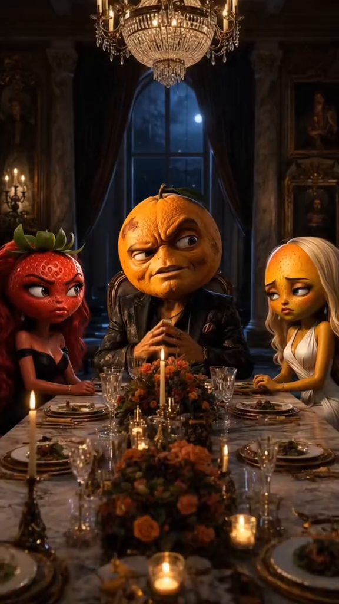

## A02

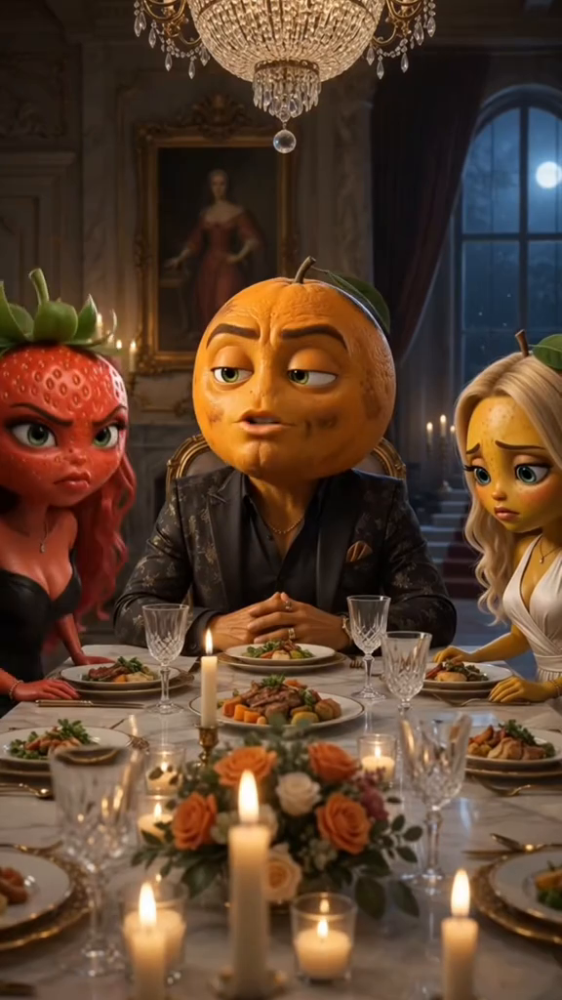

## A03

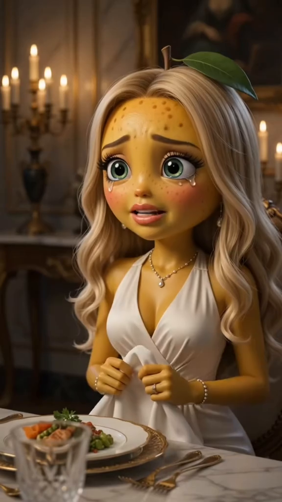

## A04

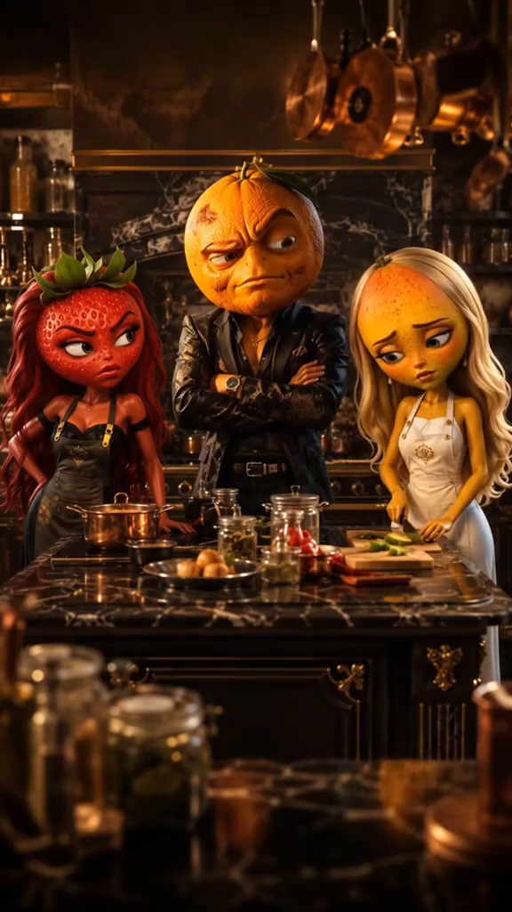

## A05

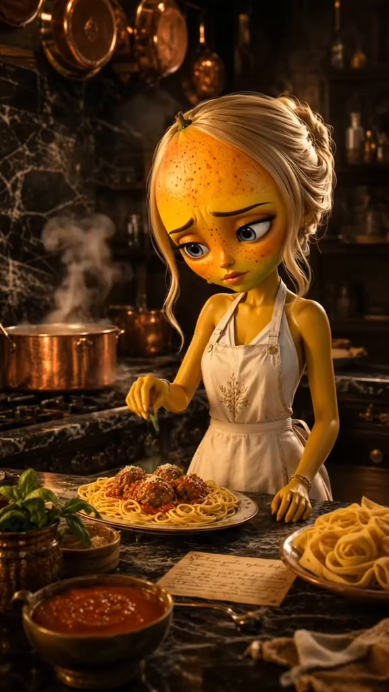

## A06

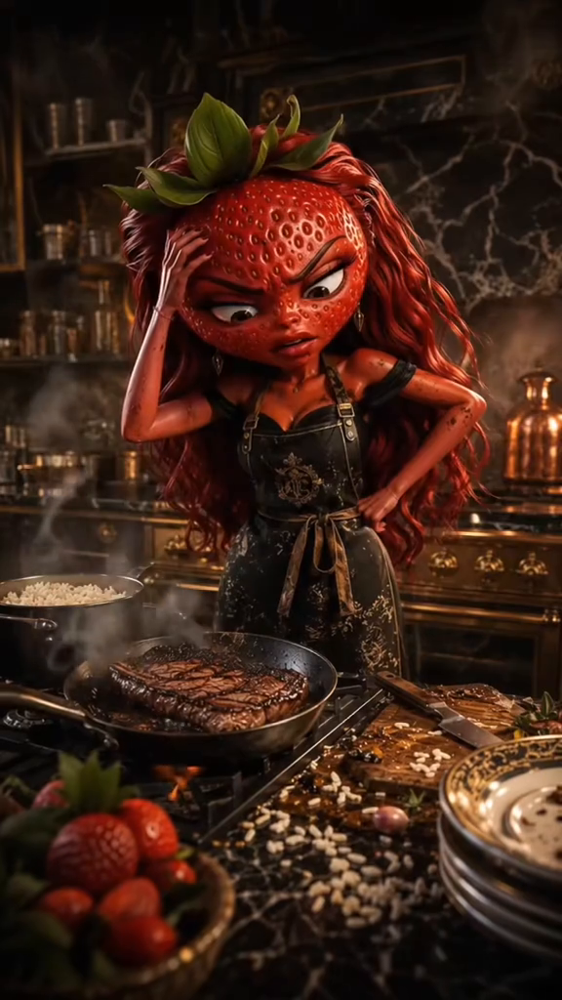

## A07

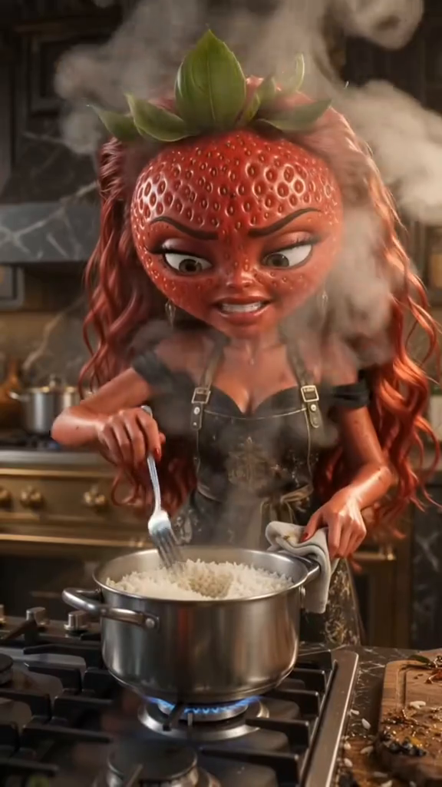

## A08

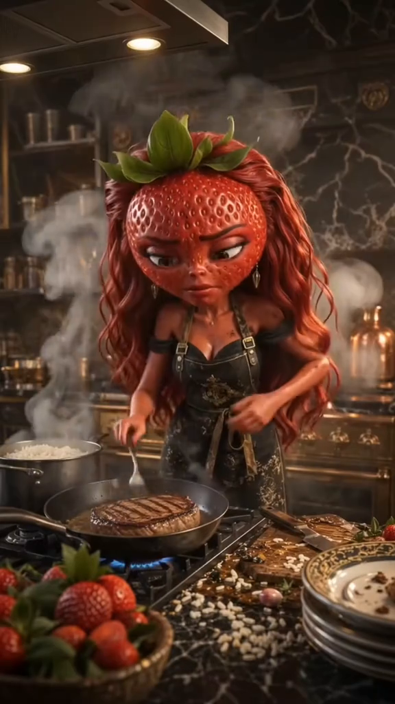

## A09

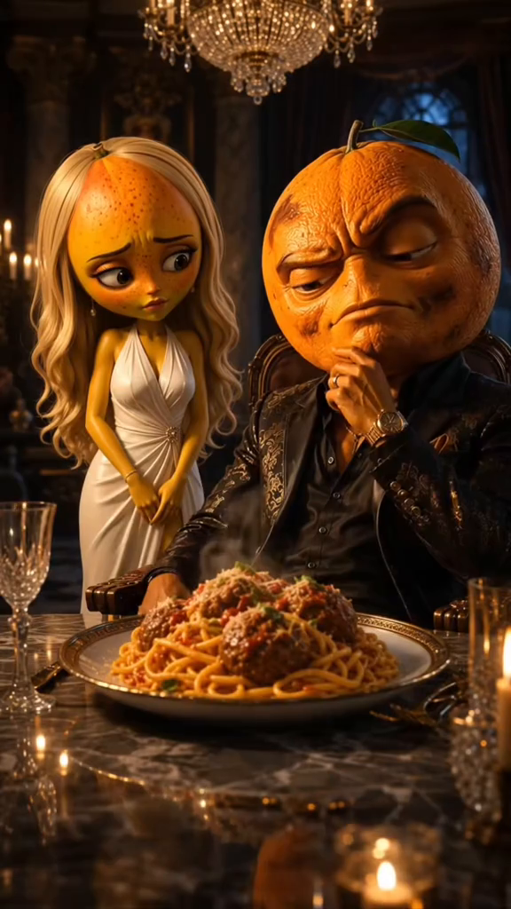

## A10

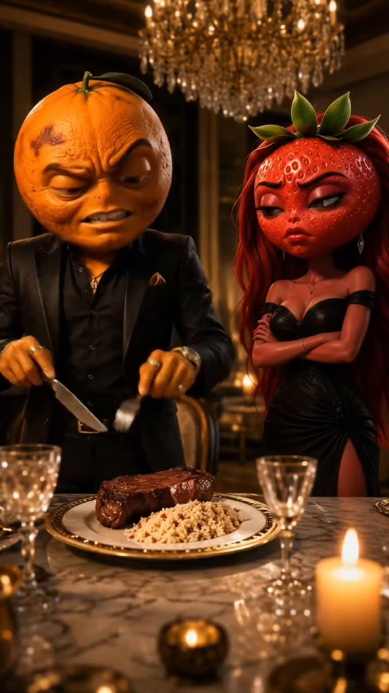

## A11

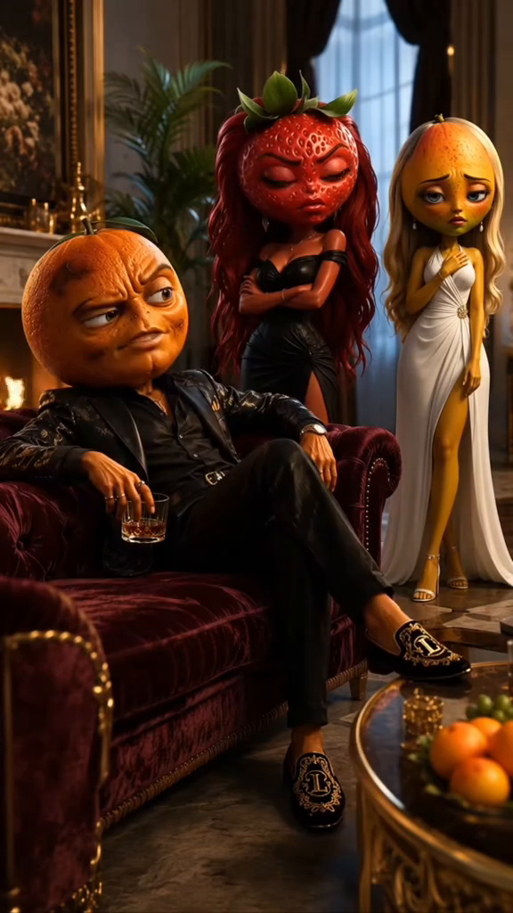

## A12

## A13

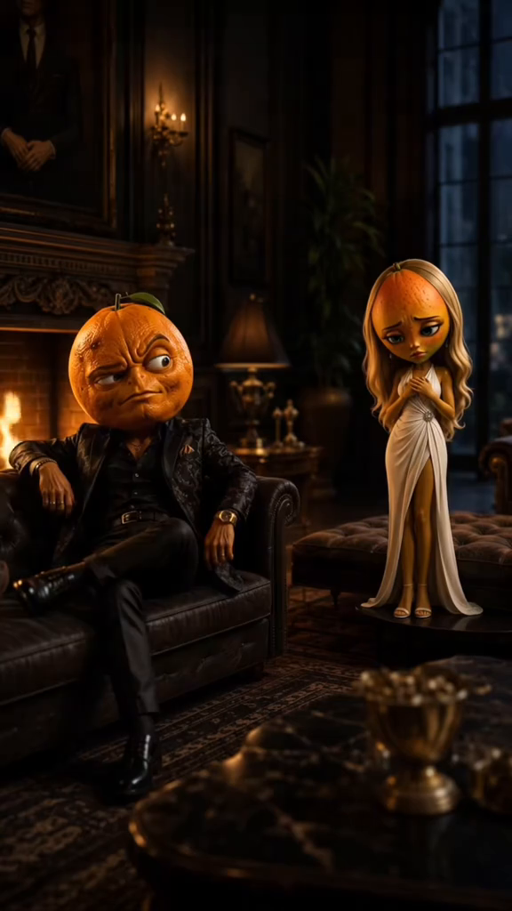

## A14

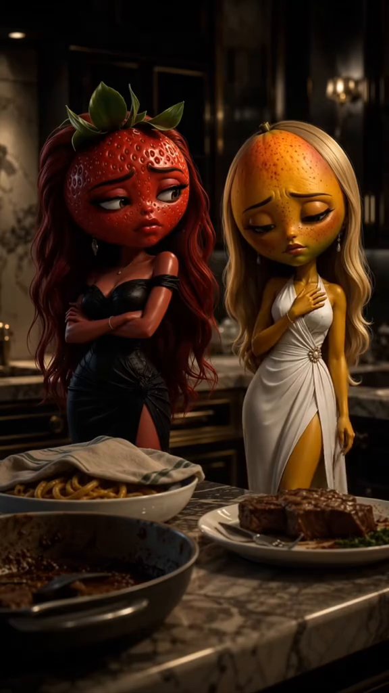

## A15

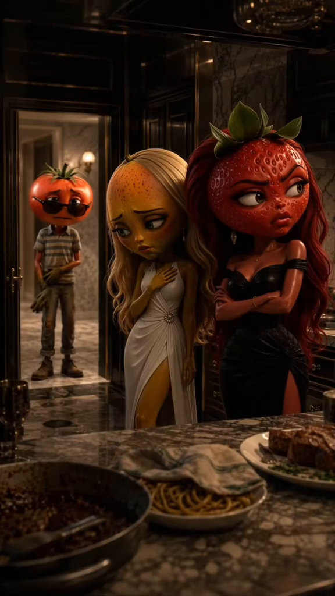

## A16

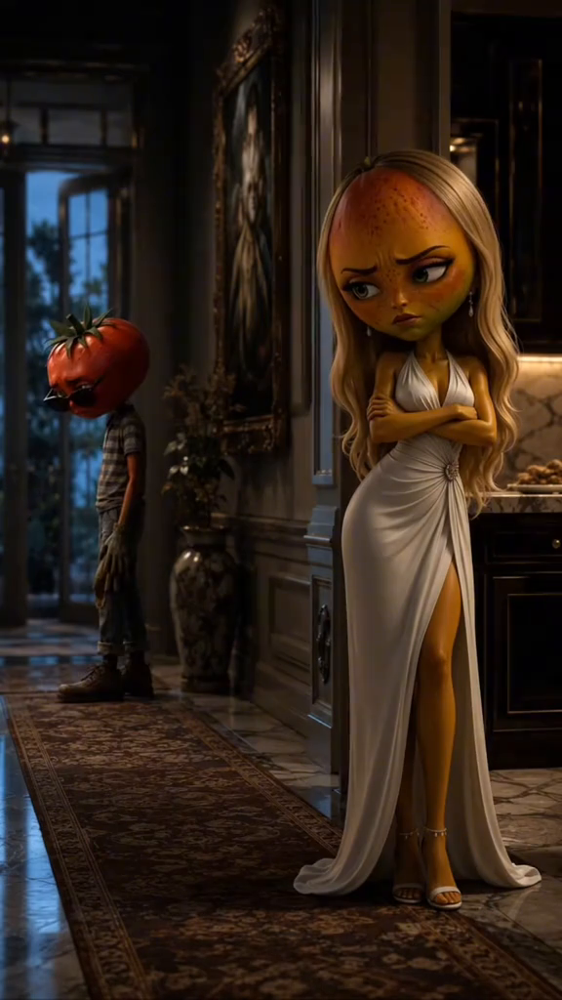

## A17

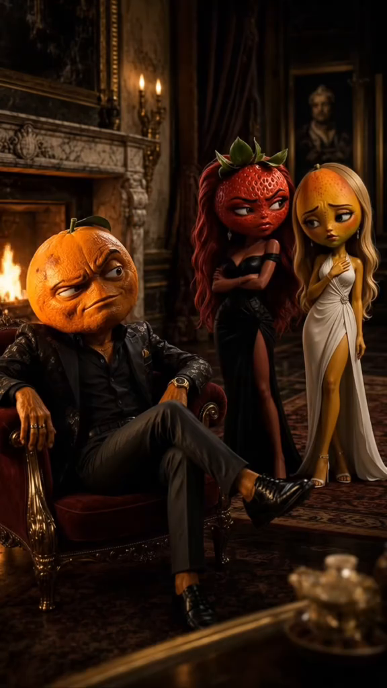

## A18

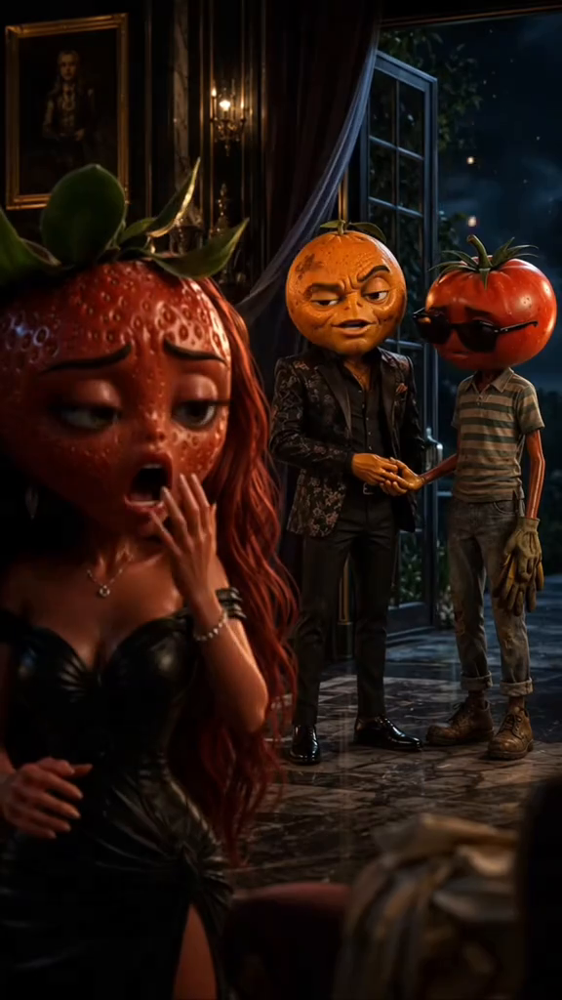

